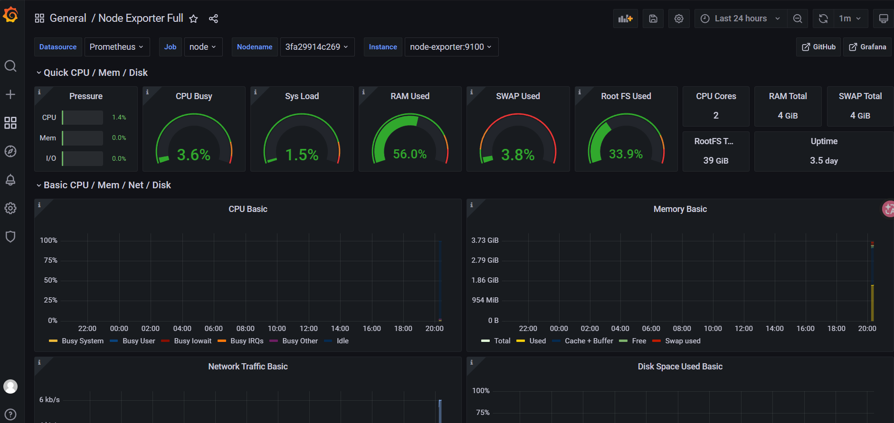
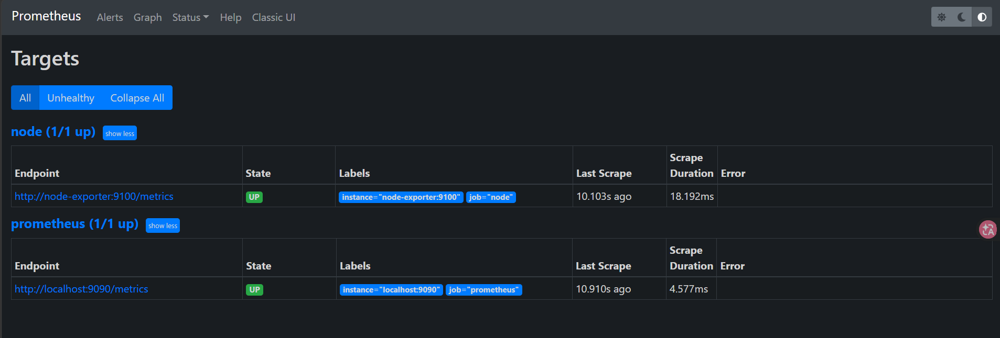
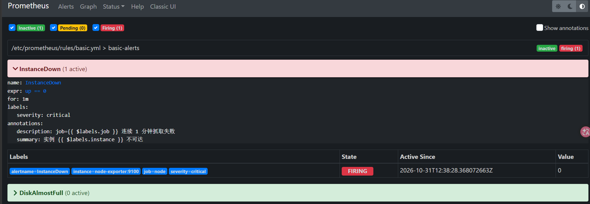
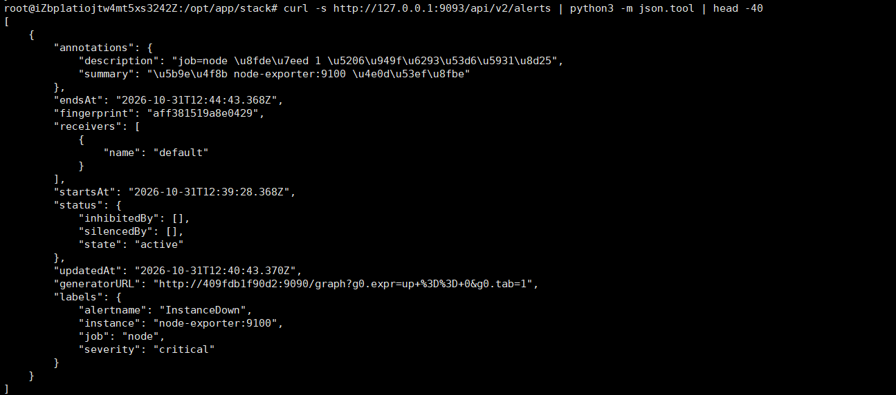
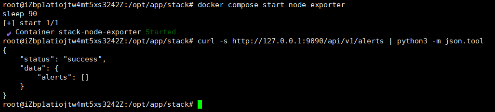

# 06 · Prometheus + Grafana + Alertmanager 监控告警

> 本文档基于 2026-10-31 的真实搭建与演练过程，含三态告警全过程与踩坑记录。

---

## 1. 架构与端口

| 组件 | 镜像 | 端口 | 作用 |
| --- | --- | --- | --- |
| Prometheus | prom/prometheus（实际拉到 2.32.1） | 9090 | 抓取指标、按规则判定告警 |
| node-exporter | prom/node-exporter | 9100（仅本机） | 暴露主机 CPU/内存/磁盘/网络指标 |
| Alertmanager | prom/alertmanager | 9093 | 告警去重、分组、路由到钉钉/邮件 |
| Grafana | grafana/grafana | 3000 | 可视化面板 |

数据流：

```
node-exporter (9100) ──pull──► Prometheus (9090) ──规则判定──► Alertmanager (9093) ──► 钉钉/邮件
                                     │
                                     └────► Grafana (3000) 查询展示
```

## 2. 配置

### 2.1 抓取配置 `conf/prometheus/prometheus.yml`

```yaml
global:
  scrape_interval: 15s
  evaluation_interval: 15s

alerting:
  alertmanagers:
    - static_configs:
        - targets: ["alertmanager:9093"]

rule_files:
  - /etc/prometheus/rules/*.yml

scrape_configs:
  - job_name: prometheus
    static_configs:
      - targets: ["localhost:9090"]

  - job_name: node
    static_configs:
      - targets: ["node-exporter:9100"]
```

**关键点**：`alertmanager:9093`、`node-exporter:9100` 都是**容器服务名**，走 Docker 内置 DNS，不用 IP。

### 2.2 告警规则 `conf/prometheus/rules/basic.yml`

```yaml
groups:
  - name: basic-alerts
    rules:
      - alert: InstanceDown
        expr: up == 0
        for: 1m
        labels:
          severity: critical
        annotations:
          summary: "实例 {{ $labels.instance }} 不可达"
          description: "job={{ $labels.job }} 连续 1 分钟抓取失败"

      - alert: DiskAlmostFull
        expr: (1 - node_filesystem_avail_bytes{fstype!~"tmpfs|overlay|squashfs"} / node_filesystem_size_bytes{fstype!~"tmpfs|overlay|squashfs"}) * 100 > 85
        for: 2m
        labels:
          severity: warning
        annotations:
          summary: '磁盘使用率 {{ printf "%.1f" $value }}%'
          description: "挂载点 {{ $labels.mountpoint }} 超过 85%"
```

| 元素 | 作用 |
| --- | --- |
| `expr` | 判定表达式，结果为真即进入 pending |
| `for: 1m` | 必须持续 1 分钟才转 firing，**防抖动误报** |
| `labels.severity` | 分级，配合 Alertmanager 路由（critical 打电话、warning 发群） |
| `annotations` | 告警文案，`$labels.*` 和 `$value` 是模板变量 |
| `fstype!~"tmpfs\|overlay"` | 排除虚拟文件系统，否则告警会被 tmpfs 刷屏 |

### 2.3 Alertmanager `conf/alertmanager/alertmanager.yml`

```yaml
global:
  resolve_timeout: 5m

route:
  receiver: default
  group_by: [alertname]
  group_wait: 10s
  group_interval: 1m
  repeat_interval: 1h

receivers:
  - name: default
```

## 3. 部署要点（含两个必踩的权限坑）

```bash
cd /opt/app/stack
mkdir -p conf/prometheus/rules conf/alertmanager data/prometheus data/grafana

# 关键：容器内运行用户与宿主机目录属主必须匹配
chown -R 65534:65534 data/prometheus    # prometheus 以 nobody(65534) 运行
chown -R 472:472     data/grafana       # grafana 以 472 运行

docker compose up -d prometheus alertmanager node-exporter grafana
```

不 chown 的后果：容器不断 `Restarting`，日志里是

```
Failed to create directory for logging active queries
GF_PATHS_DATA='/var/lib/grafana' is not writable
```

## 4. 验证

```bash
# 1. 存活
curl -s http://127.0.0.1:9090/-/healthy          # Prometheus is Healthy.

# 2. 抓取目标（两个都应为 up）
curl -s http://127.0.0.1:9090/api/v1/targets | python3 -c "
import sys, json
for t in json.load(sys.stdin)['data']['activeTargets']:
    print(t['labels']['job'], t['health'], t['scrapeUrl'])
"
# node up http://node-exporter:9100/metrics
# prometheus up http://localhost:9090/metrics

# 3. 规则已加载
curl -s http://127.0.0.1:9090/api/v1/rules | python3 -m json.tool | head -20

# 4. 配置语法校验（改完规则先跑这个）
docker compose run --rm --entrypoint promtool prometheus check config /etc/prometheus/prometheus.yml
```

Grafana：

1. `http://<公网IP>:3000`，账号 `admin` / `.env` 里的 `GRAFANA_PASSWORD`
2. Data source 填 **`http://prometheus:9090`**（容器内用服务名，填 `localhost:9090` 必失败）
3. Import dashboard ID **1860**（Node Exporter Full）

## 5. 告警演练：pending → firing → resolved

```bash
# 制造故障
docker compose stop node-exporter

sleep 30
curl -s http://127.0.0.1:9090/api/v1/alerts      # state: pending（未到 for 时长）

sleep 60
curl -s http://127.0.0.1:9090/api/v1/alerts      # state: firing
curl -s http://127.0.0.1:9093/api/v2/alerts      # status.state: active（已推送）

# 恢复
docker compose start node-exporter
sleep 90
curl -s http://127.0.0.1:9090/api/v1/alerts      # {"alerts": []} 自动清除
```

| 状态 | 含义 | 是否推送 Alertmanager |
| --- | --- | --- |
| `inactive` | 条件不满足 | 否 |
| `pending` | 条件满足，但未达 `for` 时长 | **否** |
| `firing` | 超过 `for` 时长，正式触发 | 是 |
| resolved | 条件恢复，告警自动结束 | 是（发恢复通知） |

实测踩坑：第一次停掉 node-exporter 后只等了十几秒就查，看到的是 `pending`，Alertmanager 里是 `[]`；而且紧接着就 `start` 了，告警**永远到不了 firing**。教训：演练告警必须等够 `for` 的时长。

## 6. 踩坑清单

| 现象 | 根因 | 解决 |
| --- | --- | --- |
| 容器 `Restarting` | 数据目录属主不对（65534 / 472） | `chown -R` 对应 uid |
| `docker logs` 里规则报错 | 规则 YAML 语法或模板写错 | `promtool check config` 先校验 |
| Grafana 数据源 Save & test 失败 | 填了 `localhost:9090` | 改 `http://prometheus:9090` |
| 告警一直是 pending | 没等够 `for` 时长 | 等 1-2 分钟再查 |
| `latest` 拉到 2.32.1 | 镜像加速器缓存旧版本 | 生产固定版本号，如 `prom/prometheus:v2.51.0` |
| 9090/3000 对公网开放 | 默认映射 0.0.0.0 | 安全组限制来源 IP + 改 Grafana 默认密码 |

## 7. 生产接钉钉（配置思路）

Alertmanager 原生**不支持**钉钉的 JSON 格式，需要中间层转换（`prometheus-webhook-dingtalk` 或自建 relay）：

```yaml
receivers:
  - name: dingtalk
    webhook_configs:
      - url: 'http://dingtalk-webhook:8060/dingtalk/webhook1/send'
        send_resolved: true
```

```yaml
route:
  receiver: dingtalk
  routes:
    - matchers: ['severity="critical"']
      receiver: dingtalk
      repeat_interval: 10m
```

## 8. 截图










