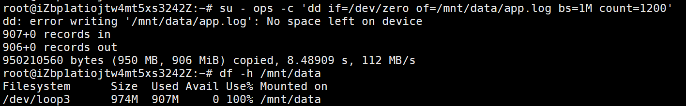
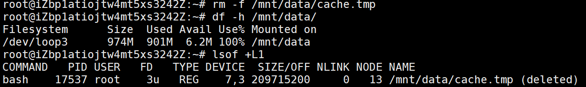
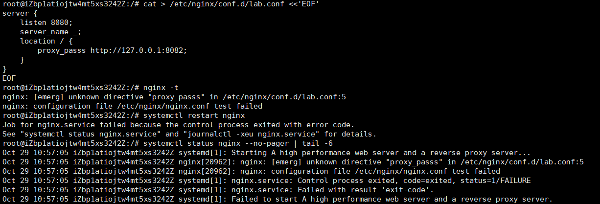
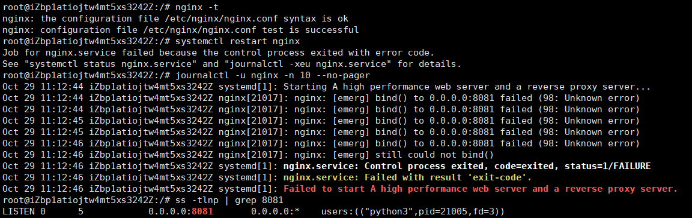
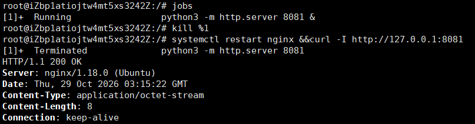
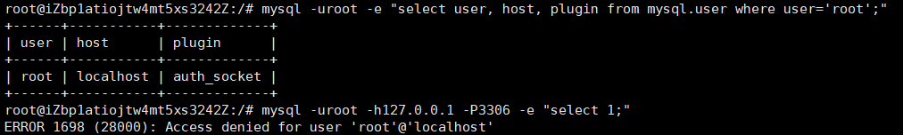
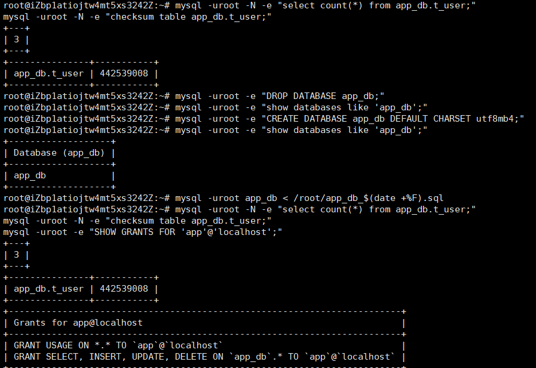

# 07 · Linux 故障排查手册

> 用法：每次遇到问题，先按这个模板记录，再回来补全。
> 面试时被问「你处理过什么故障」，你打开这一页就够了。
> 写满 20 个场景，比简历上写十句「熟悉」有用。

## 模板（复制这一段）

```markdown
### 场景 N：一句话描述现象

- **环境**：CentOS 7.9 / 2C2G / Nginx 1.20 + MySQL 8.0
- **现象**：用户看到什么、日志报什么、什么时候开始
- **定位过程**：
  ```bash
  # 1. 先看整体
  # 2. 再缩小范围
  # 3. 确认根因
  ```
  （每步写命令 + 关键输出，不要只写命令）
- **根因**：一句话说清，不要写「配置错误」这种废话
- **修复**：改了什么、改了哪一行
- **验证**：用什么命令证明已经好了
- **复盘**：怎么避免再次发生（监控项 / 规范 / 脚本）
```

---

## 场景 1：分区磁盘写满，应用报 No space left on device

- **环境**：Ubuntu 22.04.5 / 2C4G / 用 1G loop 盘模拟生产系统盘（避免把云主机写死、SSH 登不上）
- **现象**：`dd` 报 `No space left on device`；`df` 显示 100%、Avail 0；普通用户写不进去，root 仍能写
- **定位过程**：

```bash
df -h /mnt/data                 # /dev/loop3  974M  901M  6.2M  100%
du -xsh /mnt/data/* | sort -h   # 907M  /mnt/data/app.log
ls -lah /mnt/data               # -rw-rw-r-- 1 ops ops 907M app.log
lsof +L1                        # 找到持有句柄的进程
```

- **根因**：应用日志只追加、不切割，`app.log` 涨到 907M 写满分区
- **修复**：`truncate -s 0` 清空 → 配 logrotate 按天切割、保留 7 份、压缩
- **验证**：`df` 回落到 1%；`logrotate -f` 后生成 `app.log-20261028.gz`，原文件归零
- **复盘**：
  - ext4 默认给 root 保留 5%（本机 `Reserved block count: 13107` ≈ 52MB），所以 100% 时 root 还能写、普通用户先报错 —— 复现故障要用业务账号
  - `rm` 后空间不释放：进程持有 fd，`lsof +L1` 能看到 `209715200 ... (deleted)`；用 `: > /proc/<PID>/fd/<FD>` 原地清空，进程无需重启

### 复现记录（2026-10-28）






---

## 场景 2：启动服务提示 8080 端口已被占用

- **环境**：CentOS 7.9
- **现象**：`java -jar app.jar` 启动失败，日志 `Address already in use: bind`
- **定位过程**：

```bash
# 1. 看谁在监听 8080
ss -tlnp | grep ':8080'
# LISTEN 0 128 *:8080 *:* users:(("java",pid=2317,fd=98))

# 2. 确认这个进程是什么
ps -fp 2317
ls -l /proc/2317/cwd     # 看工作目录，判断是哪个应用

# 3. 如果是自己上一次没退干净的进程，杀掉；如果是别的业务，改端口
kill -15 2317
sleep 2 && ss -tlnp | grep ':8080'
```

- **根因**：旧的 jar 进程没有正常退出（kill -9 之后父进程重新拉起），新实例抢不到端口
- **修复**：`systemctl stop app` 停干净 → 确认端口释放 → 再启动；部署脚本里加「启动前检测端口」逻辑（见 `scripts/deploy.sh`）
- **验证**：`ss -tlnp | grep 8080` 只有一个 PID，且是新启动的；`curl -I http://127.0.0.1:8080` 返回 200
- **复盘**：部署脚本必须做端口占用检查，不能盲目启动

---

## 场景 3：Nginx 起不来 —— 语法错 vs 端口被占

- **环境**：Ubuntu 22.04.5 / Nginx 1.18.0
- **现象**：`systemctl restart nginx` 失败，报 `Job for nginx.service failed`

**故障 A：配置语法错**

```bash
nginx -t
# nginx: [emerg] unknown directive "proxy_passs" in /etc/nginx/conf.d/lab.conf:5
systemctl status nginx --no-pager | tail -6
# Stopping... Deactivated successfully      ← restart 先把老进程停了
# Failed to start                           ← 新进程起不来，服务全挂
```

- **根因**：`proxy_pass` 拼成了 `proxy_passs`，指令不存在
- **修复**：改正拼写 → `nginx -t` 通过 → `systemctl restart`
- **复盘**：生产必须 `nginx -t && systemctl reload`。`reload` 是平滑重载，配置错只拒绝加载，老 worker 继续服务；`restart` 是 stop + start，配置错等于把服务停死

**故障 B：端口被占**

```bash
nginx -t          # 通过！语法没错
systemctl restart nginx
# bind() to 0.0.0.0:8081 failed (98: Address already in use)
ss -tlnp | grep 8081
# LISTEN 0 5 0.0.0.0:8081 0.0.0.0:* users:(("python3",pid=21005,fd=3))
kill 21005 && systemctl restart nginx
curl -I http://127.0.0.1:8081     # HTTP/1.1 200 OK, Server: nginx/1.18.0
```

- **根因**：另一个进程（python http.server）占了 8081
- **复盘**：`nginx -t` 只检查语法，**不检查端口占用**；端口冲突要到 bind 时才暴露。注意 nginx 重试时报错会从 `Address already in use` 变成 `Unknown error`，判断看错误码 **98**
### 复现记录（2026-10-29）





---

## 场景 4：MySQL 无法登录（1045 / 1698）与备份恢复演练

- **环境**：Ubuntu 22.04.5 / MySQL 8.0.46

### A. root 本地能进，走 TCP 报 1698

```bash
mysql -uroot -e "select user,host,plugin from mysql.user where user='root';"
# +------+-----------+-------------+
# | root | localhost | auth_socket |
mysql -uroot -h127.0.0.1 -P3306 -e "select 1;"
# ERROR 1698 (28000): Access denied for user 'root'@'localhost'
```

| 错误码 | 含义 | 典型场景 |
| --- | --- | --- |
| 1045 | 密码错 / 用户不存在 / 授权主机不匹配 | 密码打错、`root@'%'` 未授权 |
| 1698 | 认证插件拒绝 | `auth_socket` 只认本地 socket，走 TCP 必然失败 |

- **根因**：`auth_socket` 认证看的是「当前系统用户是不是 root」，只对本地 socket 有效，TCP 连接无法通过
- **修复**：不要改 root 的认证插件，另建业务账号并只给必要权限

```sql
CREATE USER 'app'@'127.0.0.1' IDENTIFIED BY 'App@12345';
GRANT SELECT, INSERT, UPDATE, DELETE ON app_db.* TO 'app'@'127.0.0.1';
```

### B. 备份与恢复演练

```bash
mysqldump -uroot --single-transaction --routines --triggers --events app_db > /root/app_db_$(date +%F).sql

mysql -uroot -N -e "select count(*) from app_db.t_user;"          # 3
mysql -uroot -N -e "checksum table app_db.t_user;"                # app_db.t_user | 442539008

mysql -uroot -e "DROP DATABASE app_db;"
mysql -uroot -e "CREATE DATABASE app_db DEFAULT CHARSET utf8mb4;"
mysql -uroot app_db < /root/app_db_$(date +%F).sql

mysql -uroot -N -e "select count(*) from app_db.t_user;"          # 3
mysql -uroot -N -e "checksum table app_db.t_user;"                # 442539008
mysql -uroot -e "SHOW GRANTS FOR 'app'@'localhost';"
```

- **结果**：备份前后 `count=3`、`checksum=442539008` 完全一致；`app` 用户授权仍在
- **关键点**：
  - `--single-transaction` 依赖 InnoDB 快照读，备份过程不锁表
  - 不加 `--databases` 时导出文件里没有 `CREATE DATABASE`，恢复必须指定库名
  - `DROP DATABASE` 不会删授权（授权存在 `mysql.db`），所以库重建后应用能连但报 `Table doesn't exist`
  - 密码写在命令行会进 shell history 和 `ps`，生产用 `mysql_config_editor` 或 `~/.my.cnf`（600 权限）
  - 只比对行数不够，`CHECKSUM TABLE` 才能证明内容一致

### 复现记录（2026-10-29）




---

## 场景 5：Redis 报 Connection refused

- **环境**：Redis 6.x
- **现象**：应用报 `RedisConnectionFailureException: Connection refused`
- **定位过程**：

```bash
ss -tlnp | grep 6379          # 没有任何输出 = 服务没起
systemctl status redis -l --no-pager
tail -n 50 /var/log/redis/redis.log

# 端口通不通（从应用机器上测）
nc -zv 10.0.0.12 6379

# 若本机能连、远端不能连：看 bind 与保护模式
grep -E '^(bind|protected-mode|requirepass)' /etc/redis.conf

# 再看防火墙
firewall-cmd --list-ports
```

- **根因**：redis.conf 里 `bind 127.0.0.1` + `protected-mode yes`，只允许本机访问；应用在另一台机器上，所以被拒
- **修复**：`bind 0.0.0.0`（或内网 IP）+ 设置 `requirepass` + 防火墙只放行应用机器 IP，然后 `systemctl restart redis`
- **验证**：`redis-cli -h 10.0.0.12 -a '密码' ping` 返回 PONG；`nc -zv` 通
- **复盘**：Redis 绝不能裸奔在公网；改配置后必须两端都验证（本机 + 应用机）

---

## 场景 6：CPU 使用率 100%，但看不出是哪个业务

- **环境**：CentOS 7.9，Java 应用
- **现象**：监控告警 CPU 95%+，接口变慢
- **定位过程**：

```bash
top -o %CPU                       # 找到吃 CPU 的 PID
top -Hp 2317                      # 看该进程内哪个线程高
printf '%x\n' 2331                # 线程号转 16 进制，如 0x91b
jstack 2317 | grep -A 30 'nid=0x91b'   # 定位到具体代码行
pidstat -p 2317 1 5               # 观察持续占用
```

- **根因**：某接口死循环重试（连接池耗尽后不断重连），线程一直占 CPU
- **修复**：先限流/降级止血 → 修代码 → 灰度发布
- **验证**：CPU 回落到 20% 以下；`jstack` 不再有该热点线程
- **复盘**：加重试上限与熔断；CPU 告警阈值分级

---

## 场景 21：CentOS 上正常的脚本，搬到 Ubuntu 后「关键服务」整段空白

- **环境**：Ubuntu 22.04.5 / bash 5.1 / 脚本开头 `set -uo pipefail`
- **现象**：`check_health.sh` 在 CentOS 7 上能列出 sshd、nginx 等服务状态；在 Ubuntu 上 `[关键服务]` 后面**一行都没有**，但脚本没有报错、退出码也正常
- **定位过程**：

```bash
# 1. 单看这段判断逻辑，服务单元确实存在
systemctl list-unit-files | grep -c '^docker.service'    # 1
systemctl cat docker.service >/dev/null 2>&1; echo $?    # 0

# 2. 还原脚本里的写法，看退出码
set -o pipefail
systemctl list-unit-files | grep -q '^docker.service'
echo $?          # 141  ← 不是 0！
```

- **根因**：`grep -q` 命中第一条就立即退出并关闭管道；`systemctl` 后续还想写入 stdout，收到 **SIGPIPE**（退出码 141）。`set -o pipefail` 会把管道里任意一个非 0 退出码当成整条管道失败，于是 `if ... ; then` 被判成假，循环一次都不执行。CentOS 上单元少、输出短，写进 64K 管道缓冲区就结束了，不会触发 SIGPIPE，所以「在 CentOS 上是好的」。
- **修复**：不要用 `命令 | grep -q` 做判断，改成直接判断单元是否存在：

```bash
if systemctl cat "${unit}.service" >/dev/null 2>&1; then ... fi
```

其他可选写法：`grep -c ... >/dev/null`（读完整个输入，不提前退出）、管道后加 `|| true`、或临时 `set +o pipefail`。
- **验证**：重跑脚本，`[关键服务]` 正常输出 `ssh active`、`docker active`；`echo $?` 为 0
- **复盘**：跨发行版移植脚本的检查清单——① 服务名（sshd/ssh、crond/cron、mysqld/mysql）② 包管理器（yum/apt）③ 配置文件路径（`/etc/sysconfig` vs `/etc/default`）④ 防火墙（firewalld vs ufw）⑤ 强制访问控制（SELinux vs AppArmor）⑥ `pipefail` 下的管道写法

---

## 待补场景（本周每天补 2 个）

- [ ] 7. 内存不足触发 OOM Killer（`dmesg | grep -i 'killed process'`）
- [ ] 8. load average 很高但 CPU 不高（IO 等待，`vmstat 1` 看 wa）
- [ ] 9. SSH 连不上（防火墙 / sshd 状态 / 安全组 / 磁盘满导致无法登录）
- [ ] 10. 忘记 root 密码（GRUB 单用户模式重置）
- [ ] 11. inode 用尽（`df -i`，大量小文件）
- [ ] 12. crontab 定时任务不执行（路径 / 权限 / 环境变量 / crond 状态）
- [ ] 13. Nginx 502 与 504 的区别与定位
- [ ] 14. MySQL 连接数打满（`show processlist`、`max_connections`）
- [ ] 15. MySQL 主从延迟（`Seconds_Behind_Master`、大事务、从库压力）
- [ ] 16. 容器启动即退出（`docker logs`、退出码、启动命令）
- [ ] 17. Docker 磁盘占用过大（`docker system df`、overlay2、日志）
- [ ] 18. K8s Pod Pending / CrashLoopBackOff（`describe`、`logs`、探针）
- [ ] 19. 时间不同步导致证书校验/主从异常（`chronyc sources`、`timedatectl`）
- [ ] 20. SELinux 拦截服务（`getenforce`、`ausearch -m avc`、`setsebool`）
- [x] 21. 脚本跨发行版兼容：`set -o pipefail` + `grep -q` 触发 SIGPIPE，服务检测整段空白（CentOS 脚本搬到 Ubuntu）

