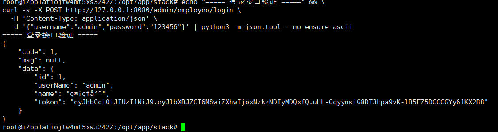

# 08 · 部署实施手册（Linux + Docker Compose 四容器）

> 本文档基于 2026-10-30 的真实部署过程整理，所有命令均可复现。
> 目标：别人照着做，不用问作者也能上线成功。

---

## 1. 项目与环境

| 项目 | 内容 |
| --- | --- |
| 应用 | sky-server（Spring Boot 2.7.3，JAR 74MB） |
| 主机 | 阿里云 ECS，Ubuntu 22.04.5 LTS，2 vCPU / 4 GiB / 40 GiB ESSD |
| 运行时 | Docker 29.9.2 + Docker Compose v5.6.1 |
| 镜像 | `openjdk:17-jdk-slim`、`mysql:8.0`、`redis:6.2`、`nginx:alpine` |
| 编排 | 单机 4 容器，bridge 网络 `stack` |
| 公网入口 | `http://<公网IP>:8080` → 容器 nginx:80 → app:8082 |

## 2. 端口规划

| 宿主机 | 容器 | 服务 | 说明 |
| --- | --- | --- | --- |
| 8080 | 80 | nginx | 唯一对外入口 |
| 13306 | 3306 | mysql | **只绑 127.0.0.1**，不暴露公网 |
| 16379 | 6379 | redis | **只绑 127.0.0.1** |
| — | 8082 | app | 不出宿主机，仅容器网络内可达 |

> 应用容器**不映射宿主机端口**，所有流量必须经 nginx 进入。对外只暴露一个口，攻击面最小。

### 2.1 网络连通性验证（实测）

```bash
# 1. 容器 DNS：服务名 → 容器 IP
docker compose exec app getent hosts mysql redis
# 172.18.0.2  mysql
# 172.18.0.3  redis

# 2. nginx → app：走容器网络 + 容器端口（不是宿主机端口）
docker compose exec nginx wget -S -qO- http://app:8082/ 2>&1 | head -6
# HTTP/1.1 404（应用无根路由，能返回 404 即证明链路通）

# 3. app → mysql：容器端口 3306，与宿主机映射的 13306 无关
docker compose exec app bash -c 'exec 3<>/dev/tcp/mysql/3306 && echo "mysql:3306 可达" && exec 3>&-'
# mysql:3306 可达
```

**结论**：容器间通信一律用「服务名 + 容器端口」，`ports:` 映射只用于容器外部访问；容器内的 `127.0.0.1` 指向容器自身，不是宿主机。

## 3. 目录结构

```
/opt/app/stack/
├── docker-compose.yml
├── .env                  # 密码，权限 600，不进 Git
├── Dockerfile            # 可选：自建 JRE 基础镜像
├── app/
│   ├── sky.jar           # 应用包，挂载进容器
│   └── lost.jar
├── sql/                  # 初始化 SQL
├── conf/app.conf         # nginx 反代配置
├── data/mysql/           # MySQL 数据（bind mount，重启不丢）
├── data/redis/
└── logs/nginx/           # 注意：挂载后 docker logs 看不到访问日志
```

## 4. 前置检查（部署前 5 分钟）

```bash
# 系统与资源
cat /etc/os-release | head -2
df -h / && free -h

# Docker 可用性
docker version && docker compose version

# 端口占用（8080/13306/16379 都应无输出）
ss -tlnp | grep -E ':(8080|13306|16379)\b'

# 镜像加速是否生效
docker info | grep -A2 'Registry Mirrors'

# 确认目录
ls -lh app/ sql/ conf/
```

## 5. 部署步骤

### 5.1 准备环境变量

```bash
cd /opt/app/stack
cat > .env <<'EOF'
MYSQL_ROOT_PASSWORD=Root@12345
MYSQL_DATABASE=sky_take_out
MYSQL_USER=app
MYSQL_PASSWORD=App@12345
REDIS_PASSWORD=Redis@12345
EOF
chmod 600 .env
```

### 5.2 先起依赖（MySQL / Redis）

```bash
docker compose up -d mysql redis
docker compose ps          # 等两个都变成 (healthy)
```

MySQL 首次初始化需要 30–60 秒，**必须等 healthy 再导数据**，否则导入会失败。

### 5.3 导入初始化 SQL

```bash
docker compose exec -T mysql mysql -uroot -p'Root@12345' sky_take_out < sql/sky.sql

# 校验表数量（应为 11）
docker compose exec -T mysql mysql -uroot -p'Root@12345' -N \
  -e "select count(*) from information_schema.tables where table_schema='sky_take_out';"
```

### 5.4 起应用容器

```bash
docker compose up -d app
docker compose logs -f app --tail=40
```

成功标志：

```
Tomcat started on port(s): 8082 (http)
Started SkyApplication in 8.392 seconds
```

本项目用**自定义配置前缀**（`sky.datasource.*`、`sky.redis.*`），必须用对应前缀的环境变量覆盖，写 `SPRING_DATASOURCE_URL` 是无效的：

```yaml
SKY_DATASOURCE_HOST: mysql
SKY_DATASOURCE_PORT: "3306"
SKY_DATASOURCE_DATABASE: sky_take_out
SKY_DATASOURCE_USERNAME: ${MYSQL_USER}
SKY_DATASOURCE_PASSWORD: ${MYSQL_PASSWORD}
SKY_REDIS_HOST: redis
SKY_REDIS_PORT: "6379"
SKY_REDIS_PASSWORD: ${REDIS_PASSWORD}
```

> 判断是否生效：看启动日志里 Druid 打印的 `url:`，如果还是 `localhost:3306`，说明覆盖没进来。

### 5.5 起入口（Nginx）

```bash
docker compose up -d nginx
docker compose ps           # 4 个容器全部 Up
```

## 6. 验证清单（缺一项都不算部署完成）

| # | 检查项 | 命令 | 期望结果 |
| --- | --- | --- | --- |
| 1 | 容器状态 | `docker compose ps` | 4 个 Up，mysql/redis/app 为 healthy |
| 2 | 入口存活 | `curl -i http://127.0.0.1:8080/` | `Server: nginx/1.21.5`，返回应用 JSON 404 |
| 3 | 反代链路 | 同上 | 响应体是 Spring Boot 的 JSON（不是 nginx 的 HTML 502） |
| 4 | 业务登录 | `curl -s -X POST .../admin/employee/login -d '{"username":"admin","password":"123456"}'` | `"code":1` 且返回 `token` |
| 5 | 数据库连通 | `select count(*) from employee;` | 有数据（1 行） |
| 6 | 缓存连通 | `docker compose exec redis redis-cli -a 'Redis@12345' ping` | `PONG` |
| 7 | 容器间解析 | `docker compose exec nginx getent hosts app` | 返回 `172.x.x.x  app` |
| 8 | 数据持久化 | `docker compose down && up -d` 后查表 | 数据仍在 |
| 9 | 故障隔离 | `docker compose stop app` 后 `curl` | 返回 502，恢复后正常 |
### 验证截图（2026-10-31）



## 7. 数据持久化与备份

- MySQL 数据在 `./data/mysql`（bind mount），`docker compose down` **不会删数据**
- 危险操作是 `docker compose down -v`：`-v` 会删命名卷（本次是 bind mount，不受影响，但别养成习惯）
- 备份：

```bash
docker compose exec -T mysql mysqldump -uroot -p'Root@12345' \
  --single-transaction --routines --triggers sky_take_out \
  | gzip > backup/sky_$(date +%F).sql.gz
```

- 恢复演练必做：备份 → `DROP DATABASE` → 重建 → 导入 → `CHECKSUM TABLE` 比对

## 8. 回滚与重建

| 场景 | 操作 |
| --- | --- |
| 应用版本回滚 | 替换 `app/sky.jar` → `docker compose up -d --force-recreate app` |
| 配置回滚 | 用备份的 `app.conf` 覆盖 → `docker compose restart nginx` |
| 整机重建 | 重装 Docker → 拉代码 → `cp .env` → `up -d` → 导入 SQL（30 分钟内） |

## 9. 常见问题

| 现象 | 根因 | 处理 |
| --- | --- | --- |
| `Bind for 0.0.0.0:8080 failed: port is already allocated` | 宿主机 8080 被占 | `ss -tlnp \| grep 8080`，看到 `docker-proxy` 说明是容器；`docker ps` 定位后停掉或换端口 |
| `not found` 拉不到镜像 | 加速器未缓存该仓库 | 换等价镜像（`openjdk:17-jdk-slim`、`nginx:alpine`），或用 `ubuntu:22.04` 自建 |
| 应用连 `localhost:3306` 报 Connection refused | 配置前缀不是 `spring.datasource` | 用 `SKY_DATASOURCE_*` 覆盖；`unzip -p jar BOOT-INF/classes/application-dev.yml` 查前缀 |
| 502 Bad Gateway | 上游容器停了 | `docker compose ps` 看 app；`logs/nginx/error.log` 看 113/111 |
| `docker logs nginx` 没有访问日志 | 挂载 `/var/log/nginx` 覆盖了镜像的 stdout 软链接 | 改看 `logs/nginx/access.log`，或不挂日志目录 |
| 登录返回「密码错误」但账号存在 | 库里存明文，应用比对 MD5 | 存 `e10adc3949ba59abbe56e057f20f883e`（123456 的 MD5） |
| 容器 healthy 但业务不可用 | 健康检查只探端口 | 改用 `/actuator/health` 或业务探针 |

## 10. 安全注意（本项目实际踩过）

1. **密钥不能进 jar、不能打日志**：`application-dev.yml` 里硬编码了 OSS AccessKey 与微信 AppSecret，且启动时打印到日志 → 已做 AK 轮换，改为环境变量注入
2. `.env` 权限 600，`.gitignore` 必须包含 `.env`、`*.jar`、`application-dev.yml`
3. MySQL/Redis 端口只绑 `127.0.0.1`，不对公网开放
4. 应用容器不映射宿主机端口，统一走 nginx
5. 密码不写在命令行（会进 history 和 `ps`），生产用 `~/.my.cnf` 或 `mysql_config_editor`

## 11. 变更记录

| 日期 | 变更 | 操作人 | 结果 |
| --- | --- | --- | --- |
| 2026-10-30 | 首次部署：4 容器 + 反向代理 + 数据导入 | 王森 | 成功 |
| 2026-10-30 | 修复密码哈希不一致（明文 → MD5） | 王森 | 登录成功 |
| 2026-10-30 | 验证持久化：down/up 后数据保留 | 王森 | 通过 |
